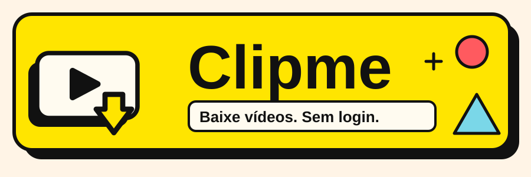
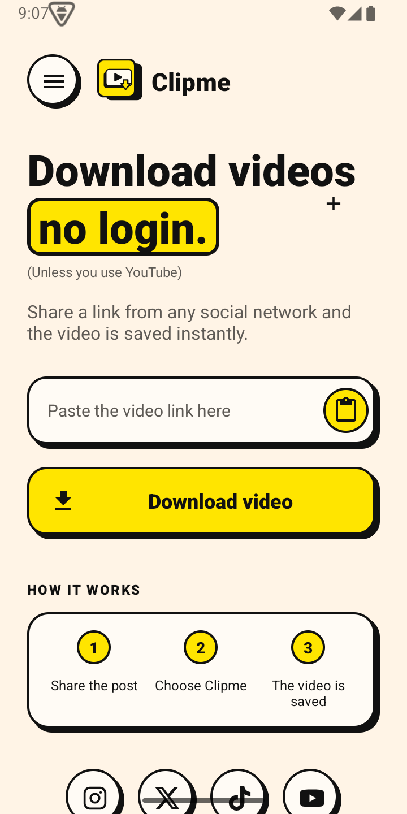
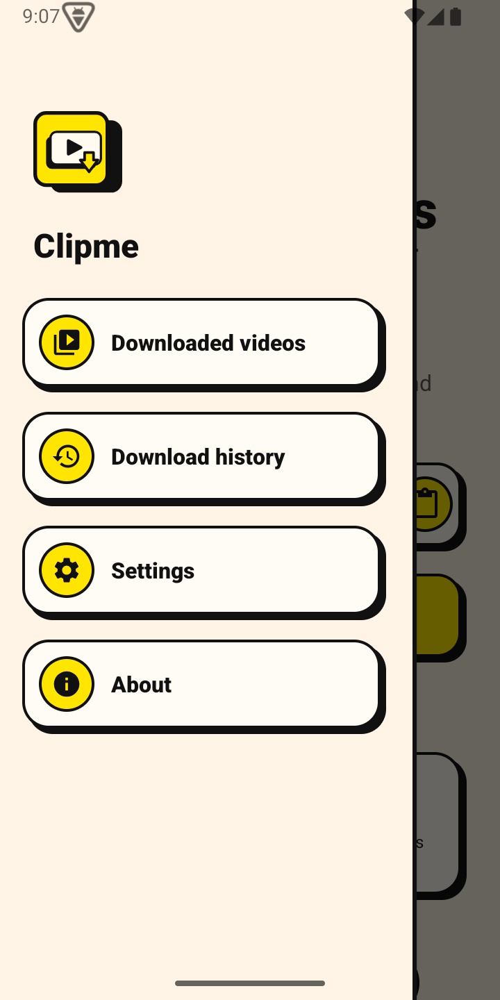
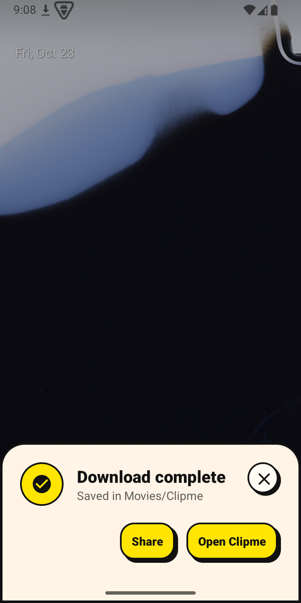
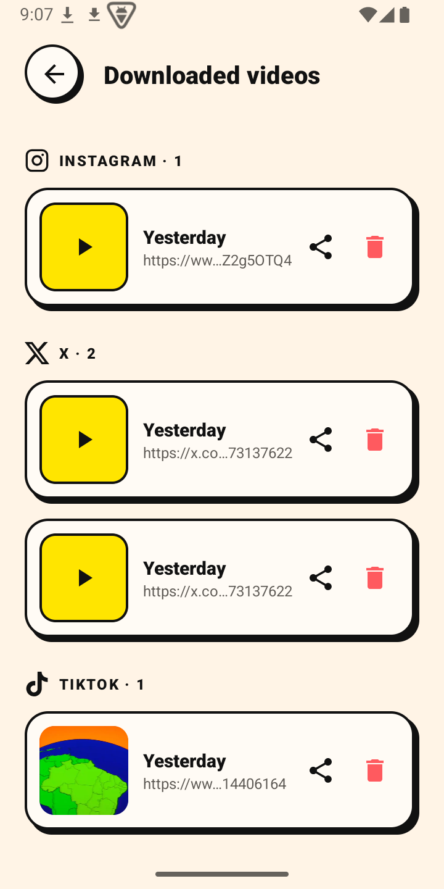
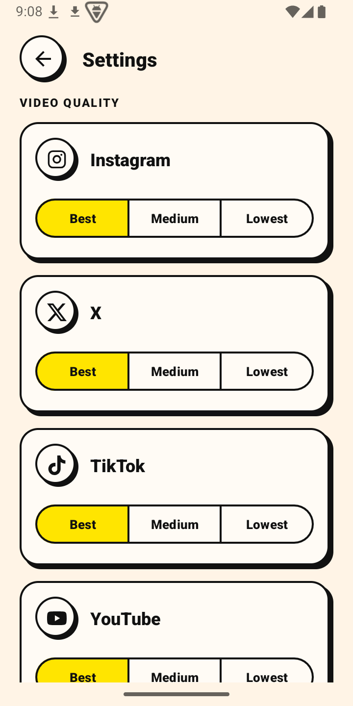
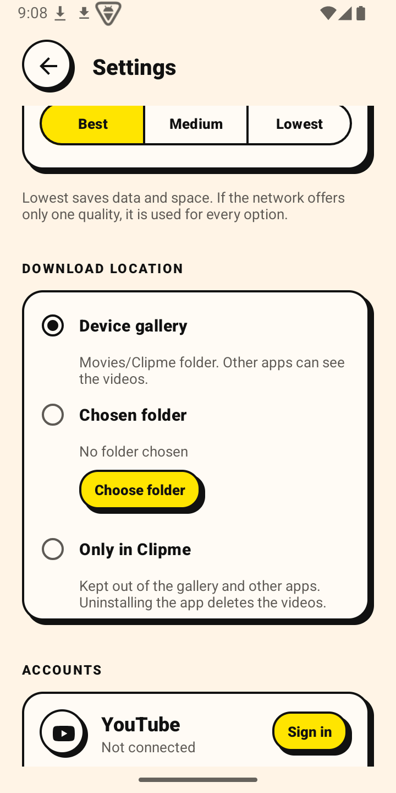

<p align="center">
  
</p>

<p align="center">
  
  
  
  
</p>

<h3 align="center">Compartilhe um link. O vídeo é salvo. Só isso.</h3>

<p align="center">
  Clipme é um app Android que baixa vídeos do <b>Instagram</b>, <b>X/Twitter</b>, <b>TikTok</b> e <b>YouTube</b><br>
  direto pelo menu <i>Compartilhar</i> do celular — sem backend, sem anúncios, sem rastreadores.
</p>


## 📱 Como é

<table>
  <tr>
    <td align="center"><br><b>Início</b></td>
    <td align="center"><br><b>Menu</b></td>
    <td align="center"><br><b>Download</b></td>
  </tr>
  <tr>
    <td align="center"><br><b>Vídeos baixados</b></td>
    <td align="center"><br><b>Qualidade por rede</b></td>
    <td align="center"><br><b>Local de download</b></td>
  </tr>
</table>


## ⚡ O que ele faz

| | |
|---|---|
| **Aparece no Compartilhar** | Em qualquer app, toque em *Compartilhar → Clipme*. O download começa na hora, numa folha na parte de baixo da tela. |
| **Cole e baixe** | Prefere colar? Cole o link na tela inicial e toque em *Baixar vídeo*. |
| **Captura automática** | Copie o link com um botão de *Copiar link* e o Clipme baixa sozinho, em segundo plano. [Veja como funciona](#-captura-automática). |
| **Qualidade por rede** | Melhor, Média ou Menor, configurável separadamente para cada rede. |
| **Você escolhe onde salvar** | Galeria (`Filmes/Clipme`), uma pasta sua, ou **só dentro do app** (privado, fora da galeria e de outros apps). |
| **Biblioteca própria** | Vídeos baixados por rede, com miniatura, player interno, compartilhar e apagar. Histórico de downloads com tag da rede. |
| **3 idiomas** | Inglês, Português (BR) e Espanhol, pelo idioma do sistema. Qualquer outro cai em inglês. |
| **Neo-brutalista** | Papel creme, tinta preta, amarelo `#FFE500` e sombras duras. Sim, de propósito. |


## 🌐 Redes suportadas

| Rede | Como o vídeo é obtido | Qualidade | Observações |
|---|---|---|---|
| **Instagram** | Lê o JSON da página pública do post/Reel | Pela resolução disponível | Posts privados não funcionam. |
| **X / Twitter** | Endpoint dos tweets embutidos (sem login) | Pelo bitrate | Se o tweet só cita um vídeo, usa o do tweet citado. |
| **TikTok** | Lê o JSON da página pública; repassa cookies da própria página | Pelo bitrate | Aceita links curtos (`vm.tiktok.com`). |
| **YouTube** | Cliente mobile da API interna; se o YouTube pedir verificação de robô, usa o seu login | Só **360p** (áudio e vídeo juntos) | Formatos maiores vêm separados e exigiriam ffmpeg. |

> [!NOTE]
> Todas as extrações são **scraping**: dependem de como cada site responde hoje. Quando uma rede muda o formato, o extrator daquela rede quebra até ser atualizado. Isso é esperado — veja [Contribuindo](#-contribuindo).


## 🤖 Captura automática

O Android 10+ **não deixa nenhum app ler a área de transferência em segundo plano** — nem receber aviso de que ela mudou. Isso vale até para serviços de acessibilidade (testado). O que dá para fazer, e é o que o Clipme faz:

1. Você liga *Baixar links copiados* em **Configurações** e ativa o serviço de acessibilidade do Clipme.
2. O serviço **só observa o rótulo** de cliques, avisos e janelas. Se o texto menciona *copy / copiar / copiado / copié…*, ele abre por um instante uma tela invisível do Clipme.
3. Essa tela ganha foco (a única condição em que o Android libera a leitura), lê o link, mostra **"Iniciando download…"** e passa o link para o serviço de download.
4. O download corre em segundo plano, com notificação de progresso.

**Limites honestos**

- Funciona com botões normais de **Copiar link** (menu de compartilhar, botões dos apps). O menu flutuante de *copiar texto selecionado* não gera evento.
- O Android mostra o aviso do sistema *"Clipme colou da área de transferência"* a cada leitura. Não dá para remover.
- Apps instalados fora de uma loja precisam de **Informações do app → ⋮ → Permitir configurações restritas** antes de ligar a acessibilidade.
- Fora isso, o Clipme também baixa o link copiado **assim que você abre o app**, e a notificação fixa tem o botão **Baixar link copiado**.


## 🚀 Instalação

Requisitos: **Android 7.0 (API 24)** ou superior.

1. Gere o APK (veja abaixo) ou baixe o de uma *release*, quando houver.
2. Instale no celular (pode ser necessário permitir a instalação de fontes desconhecidas).
3. Abra o Clipme, compartilhe um link de vídeo e pronto.

### Compilar a partir do código

Pré-requisitos: Android Studio (ou um JDK 17+) e o SDK Android com a plataforma 35.

```powershell
# PowerShell — aponte o Gradle para o JDK do Android Studio
$env:JAVA_HOME = "C:\Program Files\Android\Android Studio\jbr"

.\gradlew.bat assembleDebug     # APK em app\build\outputs\apk\debug\
.\gradlew.bat testDebugUnitTest # testes unitários dos extratores
```

```bash
# Linux / macOS
export JAVA_HOME=/caminho/do/jdk
./gradlew assembleDebug
./gradlew testDebugUnitTest
```

Para instalar direto num aparelho com Depuração USB:

```bash
adb install -r app/build/outputs/apk/debug/app-debug.apk
```

> [!TIP]
> O projeto usa **AGP 9** e **Gradle 9.1**, que rodam em JDK 25. O Gradle 8.x não suporta essa versão do JDK.


## 🧱 Como é feito por dentro

```
app/src/main/java/com/bnx/clipme/
├── Extractor.kt            # contrato: matches(url) + extract(url, quality) → Media(url, headers)
├── InstagramExtractor.kt   ┐
├── TwitterExtractor.kt     │ um extrator por rede; cada um isola o scraping
├── TikTokExtractor.kt      │ (e quebra sozinho quando o site muda)
├── YouTubeExtractor.kt     ┘
├── YouTubeWebResolver.kt   # WebView oculto que deixa o player do YouTube decifrar a URL
├── Networks.kt             # registro único das redes (ordem da UI + ícones)
├── DownloadRunner.kt       # pipeline: extrair → baixar no local escolhido → gravar histórico
├── Downloader.kt           # download em processo (pasta SAF / armazenamento privado)
├── ShareActivity.kt        # folha de download (alvo do "Compartilhar")
├── MainActivity.kt         # tela inicial + menu hambúrguer
├── ClipAccessibilityService.kt / ClipCaptureActivity.kt / ClipboardService.kt   # captura automática
└── History.kt, Settings (Quality.kt), VideoActions.kt, …
```

Decisões que valem saber:

- **Sem backend.** O app fala direto com cada site; não existe servidor do Clipme.
- **Um extrator por rede.** Todos devolvem `Media(url, headers)`. Alguns CDNs (TikTok) exigem cookies/`Referer` no download, por isso os *headers* viajam junto.
- **Três locais de download**, escolhidos em Configurações: `DownloadManager` (galeria), árvore SAF (pasta sua) e `filesDir/videos` (privado). O histórico guarda onde cada arquivo está.
- **Textos**: tudo vem de `strings.xml` (`values/` = inglês, `values-pt/`, `values-es/`).

### Adicionando uma rede nova

1. Crie `NovaRedeExtractor` implementando `Extractor` (`name`, `matches`, `extract`).
2. Registre em `Networks.extractors` e mapeie o ícone em `Networks.icon()` (vetor `ic_novarede.xml`).
3. Adicione um teste unitário do *parser* (sem rede) em `app/src/test`.
4. Se aparecer texto novo, inclua nas **três** pastas de `strings.xml`.


## 🔒 Privacidade

- Nenhum servidor próprio, **nenhuma analytics, nenhum anúncio**.
- O app só se conecta aos sites das redes para obter o vídeo.
- **Login do YouTube (opcional):** feito num WebView; o Clipme guarda **apenas o cookie da sessão**, nunca a senha. Hoje ele fica em texto puro nas preferências privadas do app — criptografar com o Keystore está na lista de melhorias.
- Histórico e configurações ficam só no aparelho.


## ⚠️ Aviso legal

> [!WARNING]
> O Clipme **não é afiliado, patrocinado nem aprovado** por Instagram, X, TikTok, YouTube ou qualquer outra empresa. Os nomes e logos pertencem aos respectivos donos.
>
> Os termos de uso dessas plataformas **restringem o download de conteúdo**. Use o Clipme apenas com vídeos que você tem o direito de salvar (os seus, com licença livre ou com autorização). **A responsabilidade pelo uso é sua.**
>
> Por esse motivo, o app provavelmente **não seria aceito** em lojas como a Google Play; a distribuição natural é pelo APK.


## 📄 Licença

Distribuído sob a **[licença MIT](LICENSE)**: você pode usar, copiar, modificar e redistribuir o código, inclusive em projetos próprios, **desde que mantenha o aviso de copyright** com o meu nome (`Copyright (c) 2026 Brunnexo`) e o texto da licença junto com o código.


## 🤝 Contribuindo

Contribuições são bem-vindas — principalmente **correções quando uma rede muda o formato**.

1. Faça um *fork* e crie uma branch.
2. Rode `./gradlew testDebugUnitTest` antes de abrir o PR.
3. Descreva o que mudou e, se for um extrator, com qual link público você testou.

Ideias em aberto: guardar o cookie do YouTube criptografado, qualidades maiores no YouTube (juntar áudio e vídeo), novas redes (Facebook, Reddit, Pinterest…), restaurar a captura automática após reiniciar o aparelho.


<p align="center">
  Feito por <a href="https://github.com/Brunnexo"><b>@Brunnexo</b></a><br>
  <sub>Amarelo, preto e sombras duras.</sub>
</p>
